# Hearth

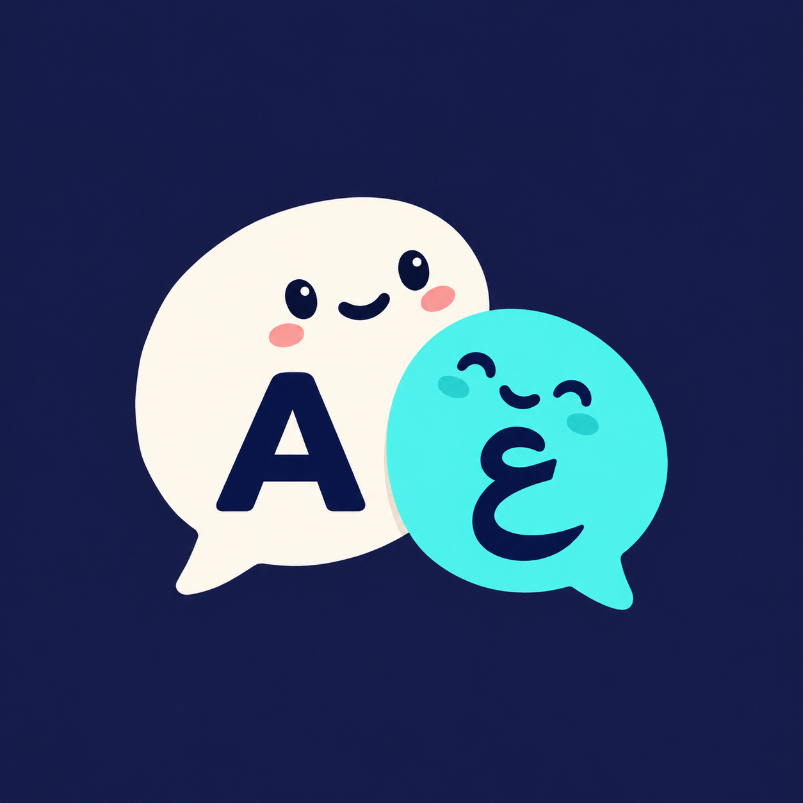

**Read speech. Translate your screen. Talk across languages.**

An Android app for live captions, translation and conversations, with a new
Windows/macOS desktop application built with Kotlin Multiplatform. Run models on
this device, use your own cloud keys, or mix local and cloud stages. Translation
and read-aloud are optional, with their own settings.
Built to make speech and languages more accessible, including for deaf and
hard-of-hearing users.

[Desktop build and integration guide](docs/desktop.md) · [Download](#download) · [Screenshots](#screenshots) · [Quick start](#quick-start) · [Models](#models-and-connections) · [Build](#build)

## Desktop

The desktop workspace accepts microphone/audio-video files and typed text, with
independent STT, translation and voice stages, floating captions and an OBS/external
app interface. Models and provider keys are managed separately.
[Desktop implementation, build targets and current coverage](docs/desktop.md).

[Set up OBS captions in four steps](docs/obs-setup.md). The Integrations page
provides a private caption link, a browser preview and separate controls for external apps.

## Download

**[Hearth 0.30.0 RC8 — Android and Mac test release](https://github.com/Sal7one/Hearth/releases/tag/v0.30.0-rc.8)**

Includes the modern benchmark lab, model downloads/imports, separate website/manga
screen translation, and the KMP desktop app with illustrated OBS setup. RC8 repairs
the screen translator chooser and aria2 HTTPS detection/download fallback. No model
weights are bundled.

| Download | Choose this for |
| --- | --- |
| **[Android Play ARM64 QA](https://github.com/Sal7one/Hearth/releases/download/v0.30.0-rc.8/hearth-0.30.0-rc.8-play-arm64-v8a-qa.apk)** | Galaxy S25 Ultra, S22 Ultra and most modern phones; cloud connections and local models |
| [Android FOSS ARM64 QA](https://github.com/Sal7one/Hearth/releases/download/v0.30.0-rc.8/hearth-0.30.0-rc.8-foss-arm64-v8a-qa.apk) | Network-free edition; import models from files |
| [Other Android APKs · individual downloads](https://github.com/Sal7one/Hearth/releases/tag/v0.30.0-rc.8) | Separate Play/FOSS APKs for ARMv7, x86, x86-64 and Universal; TVs use cloud connections |
| [Mac Apple Silicon DMG](https://github.com/Sal7one/Hearth/releases/download/v0.30.0-rc.8/hearth-1.0.3-macos-arm64.dmg) | Desktop 1.0.3; ad hoc signed, not notarized |
| [Website text extension](https://github.com/Sal7one/Hearth/releases/download/v0.30.0-rc.8/hearth-browser-extension-0.1.0.zip) | Chrome/Edge/Firefox; extract and load unpacked, then pair with Hearth |

The [release page](https://github.com/Sal7one/Hearth/releases/tag/v0.30.0-rc.8)
lists all ten Android APKs, the Mac installer, validation JSON/logs and checksums
as individual downloads. The browser extension ZIP is its installable format;
the downloader source archive is provided separately for license compliance. Windows
builds and NVIDIA execution still require matching-hardware validation; no Windows
installer is presented as verified here. [Previous releases](https://github.com/Sal7one/Hearth/releases).

Android 9+; device-audio capture requires Android 10+. The FOSS edition has **no
network permission**. These are test-signed QA builds; Play and FOSS replace each
other. **Update without uninstalling** to retain models, keys, settings and history.
Version code 104 preserves the prior QA identity/signing. Android device acceptance
belongs to the owner. [CPU and TV support](docs/android-abi-support.md).

## Screenshots

Real use shared by the project owner: Quick Settings access, English live captions,
and Arabic translation over another app. Tap an image to see it full size.

<table>
  <tr><th>Start from Quick Settings</th><th>Read live captions</th></tr>
  <tr>
    <td><a href="docs/screenshots/quick-settings.jpg">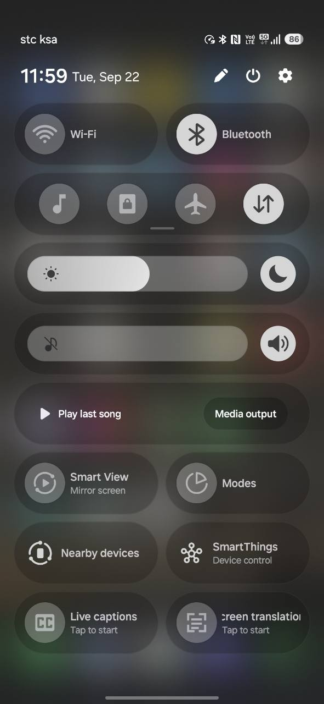</a></td>
    <td><a href="docs/screenshots/live-caption-overlay.jpg">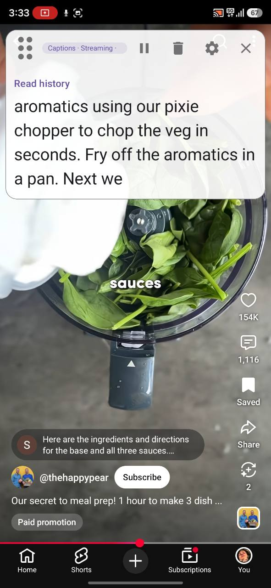</a></td>
  </tr>
  <tr><th>Translate with a transparent bubble</th><th>Move the bubble where you want</th></tr>
  <tr>
    <td><a href="docs/screenshots/translation-overlay-transparent.jpg">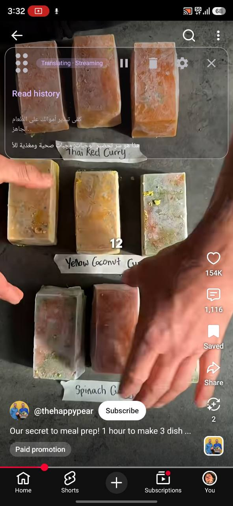</a></td>
    <td><a href="docs/screenshots/translation-overlay-bottom.jpg">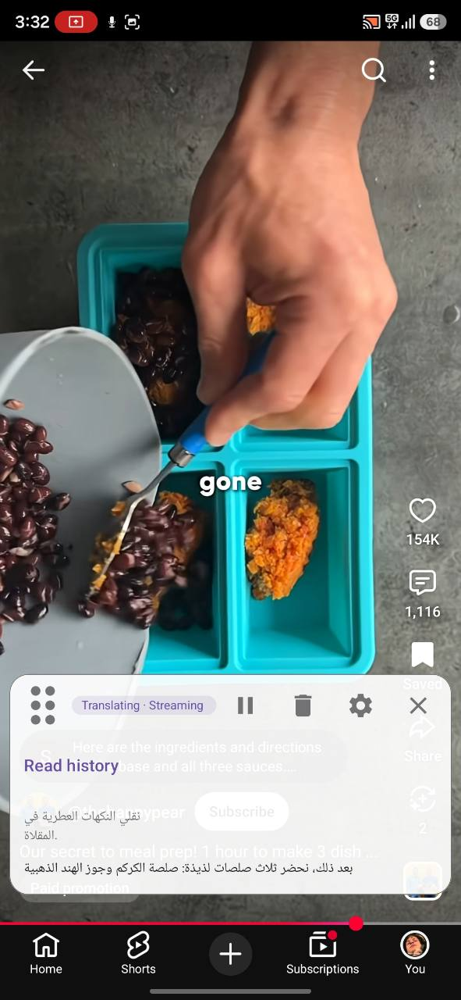</a></td>
  </tr>
</table>

The video examples show @thehappypear in YouTube; third-party content belongs to
its respective owners. [Screenshot details](docs/screenshots/README.md).

### Inside the app

Phone captures from an earlier release. Conversation and OCR examples use synthetic text.

<table>
  <tr>
    <th>Home cards</th>
    <th>Easy setup</th>
    <th>Live captions</th>
  </tr>
  <tr>
    <td><a href="docs/screenshots/home.png">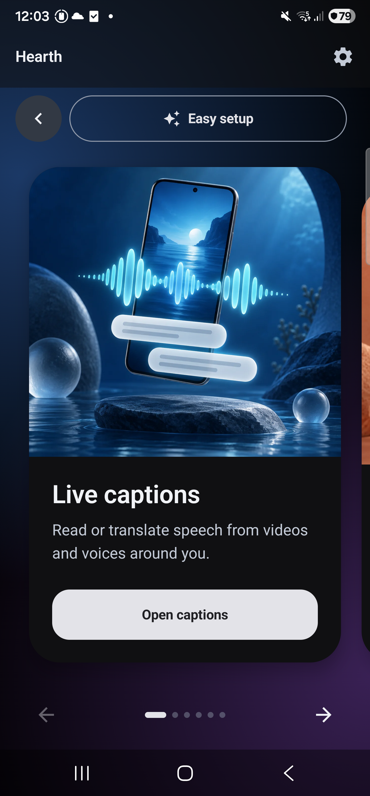</a></td>
    <td><a href="docs/screenshots/easy-setup.png">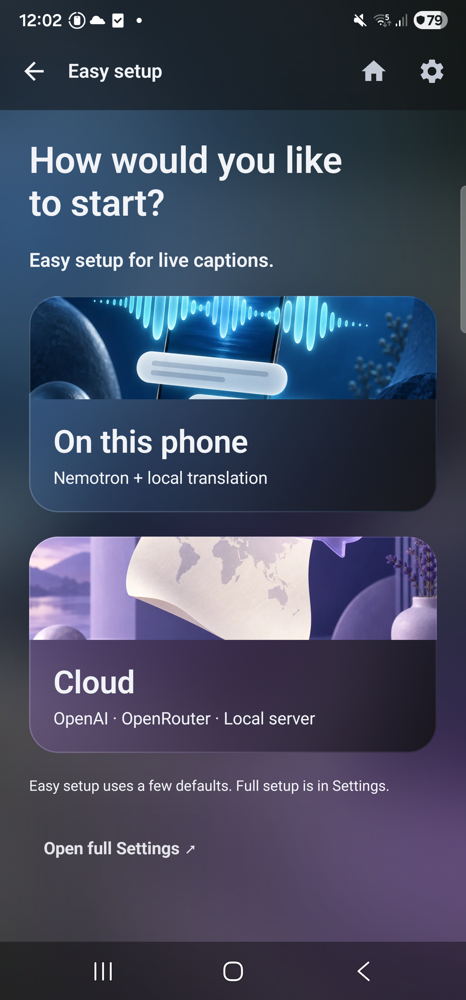</a></td>
    <td><a href="docs/screenshots/live-captions.png">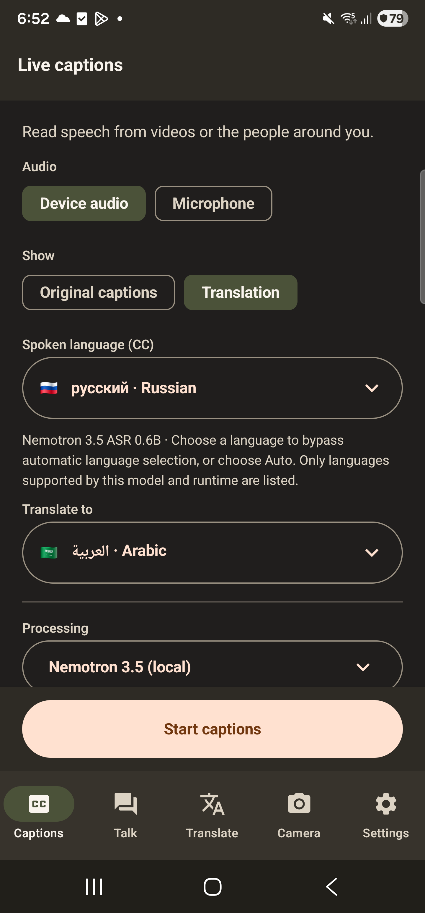</a></td>
  </tr>
  <tr>
    <th>Conversation</th>
    <th>Face to face</th>
    <th>Type to translate</th>
  </tr>
  <tr>
    <td><a href="docs/screenshots/conversation.png">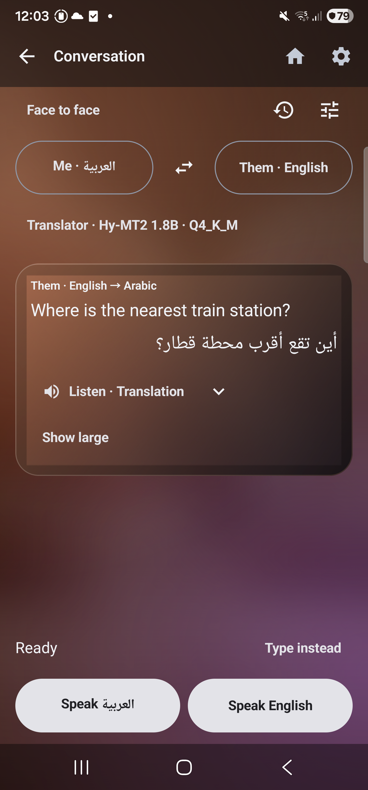</a></td>
    <td><a href="docs/screenshots/face-to-face.png">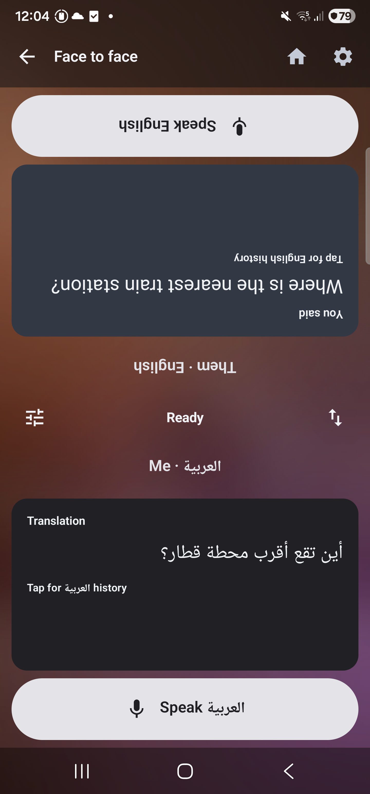</a></td>
    <td><a href="docs/screenshots/type-to-translate.png">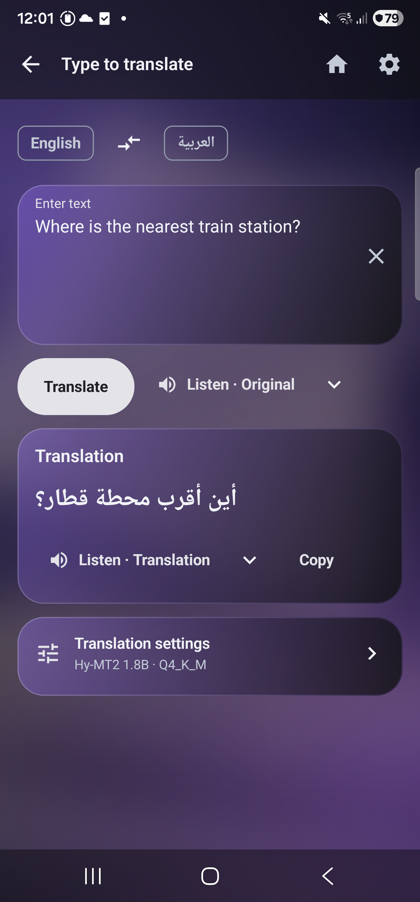</a></td>
  </tr>
  <tr>
    <th>Camera &amp; OCR</th>
    <th>Screen &amp; manga</th>
    <th>Settings</th>
  </tr>
  <tr>
    <td><a href="docs/screenshots/camera-ocr.png">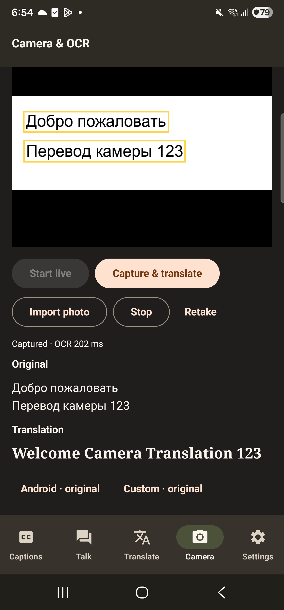</a></td>
    <td><a href="docs/screenshots/screen-reading.png">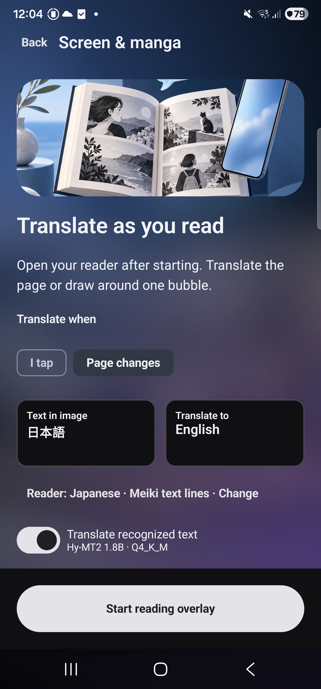</a></td>
    <td><a href="docs/screenshots/settings.png">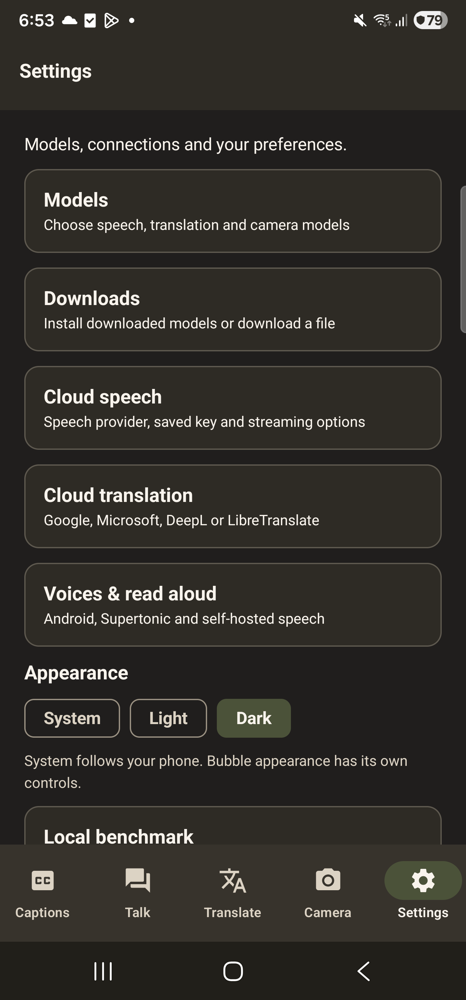</a></td>
  </tr>
</table>

### Android TV

On a TV, the home screen centers on large **Start Hearth** and **Stop Hearth**
buttons over local artwork. **Speech setup** opens compact **Speech**, **Language**
and **Voice** tabs; setup cards do not remain on the everyday dashboard. Saved
configuration is read from the current settings, including after phone pairing.
The Play build uses OpenAI in this TV setup flow, with one key reused
for its official speech and voice endpoints. FOSS offers separately installed Android system voices; downloaded local models
are blocked on TVs. Other providers and full settings remain available through
**Full interface** in setup; **TV mode** brings the TV home back. In Speech, choose **Set up from phone · QR**,
scan with iPhone or Android, paste the key and choose the three settings on the
phone, then approve them on the TV. Both devices need the same private home
network. The temporary listener closes after five minutes or when you leave.
The paired Google TV phone keyboard is also available as a fallback on supported TVs.
The background and preview images are bundled offline; [artwork prompts](docs/tv-artwork.md).
Phone layouts keep their existing home and tabs, including in landscape.

For remote-only control, open **Hearth controls** from the TV app list, or choose
**Overlay & speech controls** inside Hearth. Use the D-pad and OK to hide/show,
pause/resume, stop captions, move/resize the overlay, adjust its appearance, or
**Stop & close Hearth**. The editor has side categories for Position, Size, Text,
Style and Session, with a scrolling options pane and a large fixed preview.
The preview uses sample captions and follows the real overlay geometry and theme.

The live TV overlay contains **text only**: no inline buttons,
drag handle, history controls or translating/provider bar. **Style → Subtitles**
centers the current caption in white with a shadow, without a panel or border.
**Position → Center** places it at screen center; Bottom remains the default.
A text-panel style is also available, with controls kept in **Hearth controls**.
New/reset TV overlays use 80% width and a **64 dp** height. Size adjusts down to
**32 dp** in 8 dp steps. Saved explicit heights remain until changed; selecting
Subtitles applies the compact 64 dp preset. Phone defaults stay 80% / 30% in
landscape and 85% / 40% in portrait, with their existing 144 dp height minimum.
Speech or provider errors preserve the saved layout.
The overlay stays out of the way while controls are open and returns in its saved
position when you leave. Hiding keeps speech and read-aloud running; Stop ends both.

For an emergency exit, press Home and open **Stop Hearth** (the red stop icon) in
the TV app list. It immediately stops caption and screen-reading capture,
removes their overlays, ends their speech, and closes Hearth windows. It needs
no shortcut buttons or setup and is safe to select repeatedly while stopped.

On devices with custom Quick Settings tiles, **Live captions** now toggles capture
on/off. Long-press it to open controls. TV system quick-panel support varies by
manufacturer; the **Hearth controls** launcher entry works independently of it.


Captured directly on the owner's **TCL Smart TV Pro**, Android 14, running
**Hearth 0.23.10** in Arabic. These are unedited device screenshots of the installed
app. The illustrations and editor's sample-caption preview are built into Hearth.
[Device and capture details](docs/screenshots/tv/README.md).

<a href="docs/screenshots/tv/tv-home-tcl-0.23.10.png">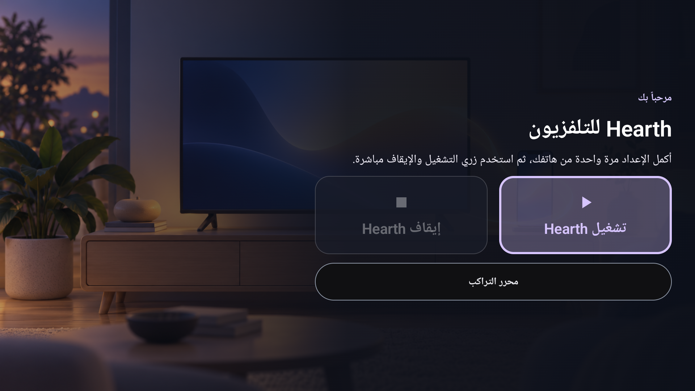</a>
<a href="docs/screenshots/tv/tv-setup-tcl-0.23.10.png">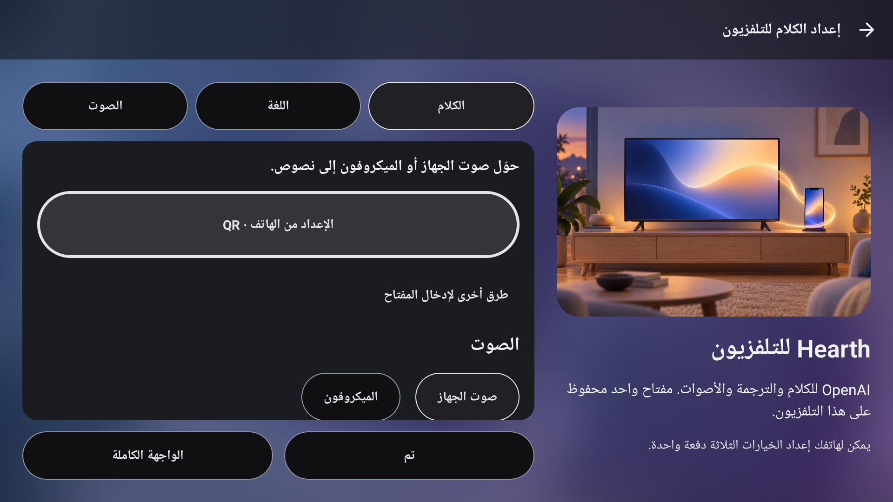</a>
<a href="docs/screenshots/tv/tv-editor-tcl-0.23.10.png">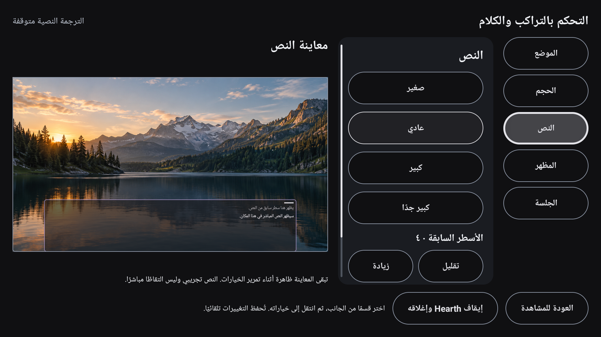</a>

## What you can do

| Feature | Controls and options |
| --- | --- |
| **Live captions** | Device audio or microphone, optional translation and read-aloud. Move/resize the overlay, adjust transparency, pause, clear, scroll or pass touches through. |
| **Read aloud** | The overlay's third **Audio** tab has male/female voice preferences, TTS loudness and device media volume. Choose Android, local, self-hosted or cloud caption voices. |
| **Saved captions** | **Off by default.** Save original CC, translations, or both when available. View/rename sessions, export TXT/JSON and delete them. History saves text, not audio. [Guide](docs/caption-history.md). |
| **Conversation / Face to face** | Speak or type in two languages; keep originals and translations, swap languages and hear replies. Face to face rotates one half for the other person. |
| **Type / selected text** | Type, copy or hear a translation in Hearth. Select text in another app → **Hearth Translate**, or **Share → Hearth Translate**, for a focused translation window without opening Home. |
| **Camera & OCR** | Translate camera or imported-photo text using local OCR and your chosen translator. |
| **Screen & manga** | Translate a shared screen or selected region; refresh after a settled page change and scroll underneath with the lock handle. [Guide](docs/screen-reading.md). |
| **Compare local models** | Try Speed first, Balanced and Quality first presets. Compare timings and outputs, test supported languages, use your own samples, and save/export results. [Benchmark guide](docs/local-benchmark.md). |

Home uses illustrated cards and remembers the last feature. **Ink + Dark** is the
default; other themes and Classic tabs are available. The interface supports
**English, العربية and 简体中文**, including Arabic RTL. Speech and translation
languages depend on the selected engine, independently of the interface language.

## Quick start

1. Open **Easy setup** and choose **On this phone** or **Cloud**. The offline build
   uses model imports; cloud setup accepts OpenAI, OpenRouter or a compatible server.
2. Open a feature, choose its languages and speech/translation setup, then start.
3. Accept Android's microphone, overlay or capture permissions when requested.
   Add translation or read-aloud only if you want them.

Choose speech, translation and voice directly in the settings sheet.
**Advanced** exposes detailed engine tuning and diagnostics; model browsing and
imports remain available from their own screens.
[Easy setup guide](docs/easy-setup.md).

For quick access, add **Live captions** and **Screen translation** through
**Settings → Phone shortcuts** or Android's Quick Settings editor. Tiles use your
saved setup; notifications provide session controls. Android capture consent
still applies, and some apps block capture. [Quick access guide](docs/quick-settings.md).

## Models and connections

| Stage | Choices |
| --- | --- |
| **Local speech** | Nemotron 3.5 ASR, Qwen3-ASR, Whisper, Vosk, English Moonshine and Phonon 2, experimental Omnilingual CTC. Optional ARM64 families add Cohere Arabic, Fun-ASR MLT Nano, Voxtral Realtime, Audar Flash and OWSM. |
| **Local translation** | HY-MT1.5 / Hy-MT2, TranslateGemma 4B, experimental MiLMMT-46 1B, Marian / OPUS-MT language pairs, QuickMT, SMaLL-100, Jisr, EuroLLM and Riva-Translate; ML Kit packs in the cloud-capable build. |
| **Cloud speech / translation** | OpenAI, OpenRouter and compatible server connections; Soniox and ElevenLabs Scribe for speech. Separate text translators include Google Cloud, Azure, DeepL and LibreTranslate. |
| **Local OCR** | PaddleOCR, Manga OCR and Meiki, with reader-specific language support. |
| **Voices** | Android voices, local Supertonic 3 plus optional Magpie, OmniVoice, MOSS Nano, Chatterbox and OuteTTS adapters; self-hosted Chatterbox/Qwen3-TTS/Fish, and cloud caption voices through OpenAI, OpenRouter, Google Gemini or ElevenLabs. |

Use **Download & install** for catalogued models, including Phonon 2, or import a
supported package. Downloads keep a verified app-owned model copy; the offline
build has no downloader. Model variants, language coverage and licenses are shown
in their setup pages. A benchmark preset is a suggestion to test on your device,
not a measured universal ranking.

On TVs, Hearth blocks downloaded local models and offers explicit cloud connections.
The offline build keeps its network restrictions on TVs too. Existing model files
and saved choices are retained so a device policy change does not delete user data.

Local speech and translation use separate models. Whisper's built-in translation
targets English; other recognizers use the selected translation stage. Provider
integrations can supply their own translation. Translator choices are remembered
by feature group; **Use everywhere** explicitly applies one across Hearth.

- [Model catalog and sources](docs/model-sources.md) · [Speech setup](docs/models.md)
- [Local translation](docs/local-translation.md) · [Translation routing](docs/translation-choices.md)
- [Camera OCR](docs/camera-ocr.md) · [Caption cloud voices](docs/cloud-tts.md) · [Other voices](docs/voices.md)
- [Model expansion and reusable TTS implementation handoff](docs/handoff/README.md):
  code maps, 15 pinned model cards, bounded agent assignments and acceptance gates.
  The handoff records implemented paths, validation evidence and remaining device checks.

## Build

Use JDK 17 for compilation and JDK 21 for Android 16 unit tests, Android SDK 36,
NDK 27.0.12077973 and CMake 3.22.1. Set ANDROID_HOME or an ignored local.properties.
Pinned native runtimes and the Gradle wrapper are included.

```sh
./gradlew test :app:compilePlayQaKotlin :app:compileFossQaKotlin
./gradlew :common-jni:externalNativeBuildDebug :app:assemblePlayQa :app:assembleFossQa
python3 scripts/verify-release.py
```

Outputs: `app/build/outputs/apk/{play,foss}/qa/` — four CPU-specific APKs and one
universal APK per flavor. QA uses the debug signing key and application ID
`com.sal7one.transiber.qa`. For production signing and native/host validation, see
[AGENTS.md](AGENTS.md), [CPU/native build guide](docs/android-abi-support.md) and
[release guide](docs/releasing.md). Never commit keys or credentials.

The **common-jni** Android library owns native model sessions, audio utilities and
JNI adapters. The app supplies UI and configuration. Shared utilities and pipeline
ownership are documented in the [utils bible](docs/utils-bible.md) and
[pipeline guide](docs/pipeline-ownership.md).

## Contribute

[Report a bug](https://github.com/Sal7one/Hearth/issues) with the version, device,
selected engines and actual error. Remove keys and private text from logs.
[Model adapters](docs/model-contributing.md), [language capabilities](docs/language-pickers.md),
[translations](docs/localization.md) and device testing are welcome.
[Changelog](CHANGELOG.md) · [Backlog](docs/BACKLOG.md).

## Privacy and license

Local models run on the device. Cloud stages send their input to the provider you
choose; credentials are stored encrypted. The offline flavor has no network
permission. [Privacy policy](PRIVACY.md) · [Security reporting](SECURITY.md).

This is the standalone caption/translation app. Media editing, FFmpeg, yt-dlp and
sign recognition are outside this repository's scope. Native package names remain
unchanged for compatibility.

First-party code: **Apache-2.0**. Runtimes and model weights have separate terms:
[THIRD_PARTY_NOTICES.md](THIRD_PARTY_NOTICES.md). Screenshot content from other
apps belongs to its respective owners.
