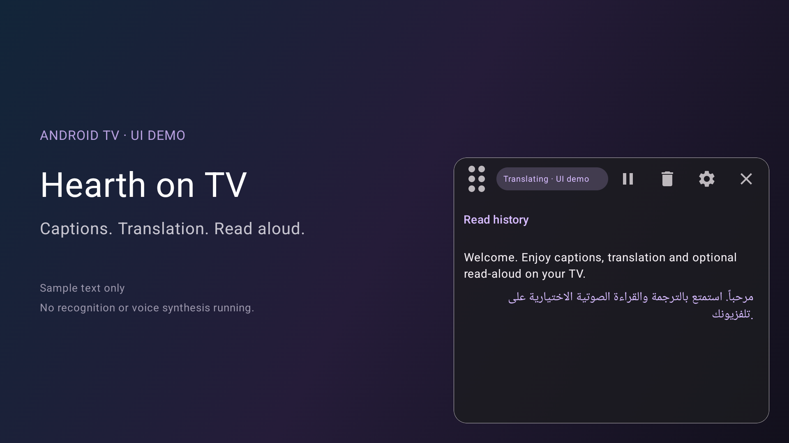
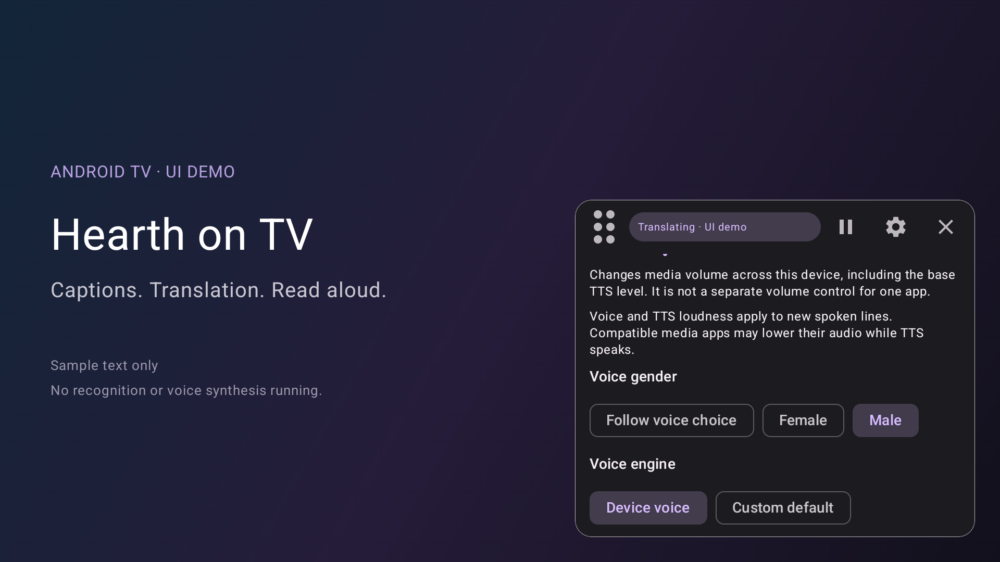

# Hearth


**Read speech. Translate your screen. Talk across languages.**

An Android app for live captions, translation and conversations. Run models on
this device, use your own cloud keys, or mix local and cloud stages. Translation
and read-aloud are optional, with their own settings.
Built to make speech and languages more accessible, including for deaf and
hard-of-hearing users.

[Download](#download) · [Screenshots](#screenshots) · [Quick start](#quick-start) · [Models](#models-and-connections) · [Build](#build)

## Download

**[Hearth 0.23.9 — release notes and SHA256SUMS](https://github.com/Sal7one/Hearth/releases/tag/v0.23.9)**

Choose **Universal** if you do not know your phone or TV's CPU.

| CPU | Cloud + local | Offline only |
| --- | --- | --- |
| **Universal · recommended** | [Download APK](https://github.com/Sal7one/Hearth/releases/download/v0.23.9/hearth-0.23.9-play-qa-universal.apk) | [Download APK](https://github.com/Sal7one/Hearth/releases/download/v0.23.9/hearth-0.23.9-foss-qa-universal.apk) |
| ARM64 | [Download APK](https://github.com/Sal7one/Hearth/releases/download/v0.23.9/hearth-0.23.9-play-qa-arm64-v8a.apk) | [Download APK](https://github.com/Sal7one/Hearth/releases/download/v0.23.9/hearth-0.23.9-foss-qa-arm64-v8a.apk) |
| ARMv7 · 32-bit | [Download APK](https://github.com/Sal7one/Hearth/releases/download/v0.23.9/hearth-0.23.9-play-qa-armeabi-v7a.apk) | [Download APK](https://github.com/Sal7one/Hearth/releases/download/v0.23.9/hearth-0.23.9-foss-qa-armeabi-v7a.apk) |
| x86_64 | [Download APK](https://github.com/Sal7one/Hearth/releases/download/v0.23.9/hearth-0.23.9-play-qa-x86_64.apk) | [Download APK](https://github.com/Sal7one/Hearth/releases/download/v0.23.9/hearth-0.23.9-foss-qa-x86_64.apk) |
| x86 · 32-bit | [Download APK](https://github.com/Sal7one/Hearth/releases/download/v0.23.9/hearth-0.23.9-play-qa-x86.apk) | [Download APK](https://github.com/Sal7one/Hearth/releases/download/v0.23.9/hearth-0.23.9-foss-qa-x86.apk) |

Android 9+; device-audio capture requires Android 10+. Cloud + local includes
optional provider connections and model downloads. Offline only has **no network
permission** and imports models from files. Model weights are separate from the APK.

These are test-signed QA builds. Both flavors replace each other. **Update without
uninstalling** to retain models, keys, settings and history. CPU support does not
remove a 32-bit device's memory limits. [CPU and TV support](docs/android-abi-support.md).

## Screenshots

Real use shared by the project owner: Quick Settings access, English live captions,
and Arabic translation over another app. Tap an image to see it full size.

<table>
  <tr><th>Start from Quick Settings</th><th>Read live captions</th></tr>
  <tr>
    <td><a href="docs/screenshots/quick-settings.jpg"></a></td>
    <td><a href="docs/screenshots/live-caption-overlay.jpg"></a></td>
  </tr>
  <tr><th>Translate with a transparent bubble</th><th>Move the bubble where you want</th></tr>
  <tr>
    <td><a href="docs/screenshots/translation-overlay-transparent.jpg"></a></td>
    <td><a href="docs/screenshots/translation-overlay-bottom.jpg"></a></td>
  </tr>
</table>

The video examples show @thehappypear in YouTube; third-party content belongs to
its respective owners. [Screenshot details](docs/screenshots/README.md).

### Inside the app

Phone captures from an earlier release. Conversation and OCR examples use synthetic text.

<table>
  <tr>
    <th>Home cards</th>
    <th>Easy setup</th>
    <th>Live captions</th>
  </tr>
  <tr>
    <td><a href="docs/screenshots/home.png"></a></td>
    <td><a href="docs/screenshots/easy-setup.png"></a></td>
    <td><a href="docs/screenshots/live-captions.png"></a></td>
  </tr>
  <tr>
    <th>Conversation</th>
    <th>Face to face</th>
    <th>Type to translate</th>
  </tr>
  <tr>
    <td><a href="docs/screenshots/conversation.png"></a></td>
    <td><a href="docs/screenshots/face-to-face.png"></a></td>
    <td><a href="docs/screenshots/type-to-translate.png"></a></td>
  </tr>
  <tr>
    <th>Camera &amp; OCR</th>
    <th>Screen &amp; manga</th>
    <th>Settings</th>
  </tr>
  <tr>
    <td><a href="docs/screenshots/camera-ocr.png"></a></td>
    <td><a href="docs/screenshots/screen-reading.png"></a></td>
    <td><a href="docs/screenshots/settings.png"></a></td>
  </tr>
</table>

### Android TV

Hearth 0.23.9 on an Android 14 TV emulator. These captures use the production
overlay with clearly labeled sample text; no speech recognition or voice playback
is implied. [All TV screenshots](docs/screenshots/tv) · [Reproduce the captures](docs/android-abi-support.md#reproduce-tv-screenshots).

<a href="docs/screenshots/tv/tv-caption-overlay.png"></a>
<a href="docs/screenshots/tv/tv-overlay-audio-voices.png"></a>

## What you can do

| Feature | Controls and options |
| --- | --- |
| **Live captions** | Device audio or microphone, optional translation and read-aloud. Move/resize the overlay, adjust transparency, pause, clear, scroll or pass touches through. |
| **Read aloud** | The overlay's third **Audio** tab has male/female voice preferences, TTS loudness and device media volume. Choose Android, local, self-hosted or cloud caption voices. |
| **Saved captions** | **Off by default.** Save original CC, translations, or both when available. View/rename sessions, export TXT/JSON and delete them. History saves text, not audio. [Guide](docs/caption-history.md). |
| **Conversation / Face to face** | Speak or type in two languages; keep originals and translations, swap languages and hear replies. Face to face rotates one half for the other person. |
| **Type / selected text** | Type, copy or hear a translation in Hearth. Select text in another app → **Hearth Translate**, or **Share → Hearth Translate**, for a focused translation window without opening Home. |
| **Camera & OCR** | Translate camera or imported-photo text using local OCR and your chosen translator. |
| **Screen & manga** | Translate a shared screen or selected region; refresh after a settled page change and scroll underneath with the lock handle. [Guide](docs/screen-reading.md). |
| **Compare local models** | Try Speed first, Balanced and Quality first presets. Compare timings and outputs, test supported languages, use your own samples, and save/export results. [Benchmark guide](docs/local-benchmark.md). |

Home uses illustrated cards and remembers the last feature. **Ink + Dark** is the
default; other themes and Classic tabs are available. The interface supports
**English, العربية and 简体中文**, including Arabic RTL. Speech and translation
languages depend on the selected engine, independently of the interface language.

## Quick start

1. Open **Easy setup** and choose **On this phone** or **Cloud**. The offline build
   uses model imports; cloud setup accepts OpenAI, OpenRouter or a compatible server.
2. Open a feature, choose its languages and speech/translation setup, then start.
3. Accept Android's microphone, overlay or capture permissions when requested.
   Add translation or read-aloud only if you want them.

Full model/provider choices are in **Settings → Local / Cloud**.
[Easy setup guide](docs/easy-setup.md).

For quick access, add **Live captions** and **Screen translation** through
**Settings → Phone shortcuts** or Android's Quick Settings editor. Tiles use your
saved setup; notifications provide session controls. Android capture consent
still applies, and some apps block capture. [Quick access guide](docs/quick-settings.md).

## Models and connections

| Stage | Choices |
| --- | --- |
| **Local speech** | Nemotron 3.5 ASR, Qwen3-ASR, Whisper, Vosk, English Moonshine and Phonon 2, experimental Omnilingual CTC. |
| **Local translation** | HY-MT1.5 / Hy-MT2, TranslateGemma 4B, experimental MiLMMT-46 1B, Marian / OPUS-MT language pairs and ML Kit packs in the cloud-capable build. |
| **Cloud speech / translation** | OpenAI, OpenRouter and compatible server connections; Soniox and ElevenLabs Scribe for speech. Separate text translators include Google Cloud, Azure, DeepL and LibreTranslate. |
| **Local OCR** | PaddleOCR, Manga OCR and Meiki, with reader-specific language support. |
| **Voices** | Android voices, local Supertonic 3, self-hosted Chatterbox/Qwen3-TTS/Fish, and cloud caption voices through OpenAI, OpenRouter, Google Gemini or ElevenLabs. |

Use **Download & install** for catalogued models, including Phonon 2, or import a
supported package. Downloads keep a verified app-owned model copy; the offline
build has no downloader. Model variants, language coverage and licenses are shown
in their setup pages. A benchmark preset is a suggestion to test on your device,
not a measured universal ranking.

Local speech and translation use separate models. Whisper's built-in translation
targets English; other recognizers use the selected translation stage. Provider
integrations can supply their own translation. Translator choices are remembered
by feature group; **Use everywhere** explicitly applies one across Hearth.

- [Model catalog and sources](docs/model-sources.md) · [Speech setup](docs/models.md)
- [Local translation](docs/local-translation.md) · [Translation routing](docs/translation-choices.md)
- [Camera OCR](docs/camera-ocr.md) · [Caption cloud voices](docs/cloud-tts.md) · [Other voices](docs/voices.md)

## Build

Use JDK 17 for compilation and JDK 21 for Android 16 unit tests, Android SDK 36,
NDK 27.0.12077973 and CMake 3.22.1. Set ANDROID_HOME or an ignored local.properties.
Pinned native runtimes and the Gradle wrapper are included.

```sh
./gradlew test :app:compilePlayQaKotlin :app:compileFossQaKotlin
./gradlew :common-jni:externalNativeBuildDebug :app:assemblePlayQa :app:assembleFossQa
python3 scripts/verify-release.py
```

Outputs: `app/build/outputs/apk/{play,foss}/qa/` — four CPU-specific APKs and one
universal APK per flavor. QA uses the debug signing key and application ID
`com.sal7one.transiber.qa`. For production signing and native/host validation, see
[AGENTS.md](AGENTS.md), [CPU/native build guide](docs/android-abi-support.md) and
[release guide](docs/releasing.md). Never commit keys or credentials.

The **common-jni** Android library owns native model sessions, audio utilities and
JNI adapters. The app supplies UI and configuration. Shared utilities and pipeline
ownership are documented in the [utils bible](docs/utils-bible.md) and
[pipeline guide](docs/pipeline-ownership.md).

## Contribute

[Report a bug](https://github.com/Sal7one/Hearth/issues) with the version, device,
selected engines and actual error. Remove keys and private text from logs.
[Model adapters](docs/model-contributing.md), [language capabilities](docs/language-pickers.md),
[translations](docs/localization.md) and device testing are welcome.
[Changelog](CHANGELOG.md) · [Backlog](docs/BACKLOG.md).

## Privacy and license

Local models run on the device. Cloud stages send their input to the provider you
choose; credentials are stored encrypted. The offline flavor has no network
permission. [Privacy policy](PRIVACY.md) · [Security reporting](SECURITY.md).

This is the standalone caption/translation app. Media editing, FFmpeg, yt-dlp and
sign recognition are outside this repository's scope. Native package names remain
unchanged for compatibility.

First-party code: **Apache-2.0**. Runtimes and model weights have separate terms:
[THIRD_PARTY_NOTICES.md](THIRD_PARTY_NOTICES.md). Screenshot content from other
apps belongs to its respective owners.
