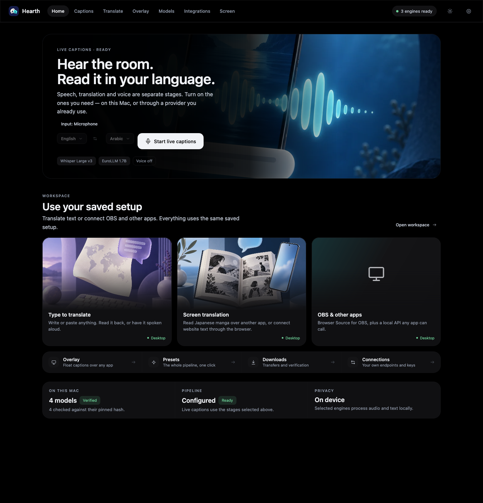
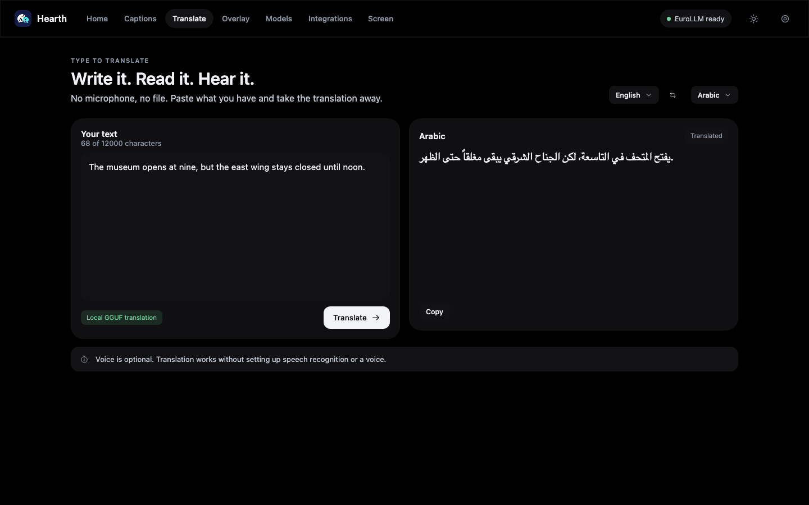

# Hearth


**Live captions. Screen translation. Conversations across languages.**

Hearth brings speech, translation and read-aloud to Android and desktop. Mix local
models with your own cloud or self-hosted connections; configure each stage independently.

[Download](#download) · [Screenshots](#screenshots) · [Guides](#guides) · [Build](#build)

## Download

| Edition | Download |
| --- | --- |
| **Android · most phones** | **[Play ARM64 · 0.30.0](https://github.com/Sal7one/Hearth/releases/download/v0.30.0/hearth-0.30.0-play-arm64-v8a-qa.apk)** |
| Android · offline | [FOSS ARM64 QA · no network permission](https://github.com/Sal7one/Hearth/releases/download/v0.30.0/hearth-0.30.0-foss-arm64-v8a-qa.apk) |
| Android · other CPUs / TV | [All individual APKs and checksums](https://github.com/Sal7one/Hearth/releases/tag/v0.30.0) |
| **Mac · Apple silicon** | **[Desktop 1.0.4 DMG](https://github.com/Sal7one/Hearth/releases/download/v0.30.0/hearth-1.0.4-macos-arm64.dmg)** |
| Browser companion | [Website text extension](https://github.com/Sal7one/Hearth/releases/download/v0.30.0-rc.8/hearth-browser-extension-0.1.0.zip) · [setup](integrations/browser-extension/README.md) |

Android 9+; device audio requires Android 10+. QA builds share the test identity
`com.sal7one.transiber.qa`; Play and FOSS replace each other. **Update without
uninstalling** to retain your models and preferences. Model weights download separately.

The Mac installer supports Apple silicon on macOS 13.3+ and is ad hoc signed,
not notarized. Windows builds and NVIDIA execution still need hardware
validation; see the [desktop guide](docs/desktop.md). **TVs use cloud speech and
translation, with installed system voices; local models are blocked.** FOSS stays offline on TVs.

## Screenshots

### Android

<table>
  <tr><th>Home</th><th>Captions over other apps</th><th>Quick access</th></tr>
  <tr>
    <td><a href="docs/screenshots/home.png"></a></td>
    <td><a href="docs/screenshots/translation-overlay-transparent.jpg"></a></td>
    <td><a href="docs/screenshots/quick-settings.jpg"></a></td>
  </tr>
</table>

[More Android captures and credits](docs/screenshots/README.md). These show earlier releases.

### Desktop

<table>
  <tr><th>Home</th><th>Typed translation</th></tr>
  <tr>
    <td valign="top"><a href="docs/screenshots/desktop/home.png"></a></td>
    <td valign="top"><a href="docs/screenshots/desktop/translate.png"></a></td>
  </tr>
</table>

Desktop UI previews with example state. [Rendering details](docs/screenshots/desktop/README.md).

### Android TV

Actual owner captures from a TCL Smart TV Pro, running Hearth 0.23.10 in Arabic.
[Capture details](docs/screenshots/tv/README.md).

<table>
  <tr><th>Home</th><th>Speech setup</th><th>Overlay editor</th></tr>
  <tr>
    <td><a href="docs/screenshots/tv/tv-home-tcl-0.23.10.png"></a></td>
    <td><a href="docs/screenshots/tv/tv-setup-tcl-0.23.10.png"></a></td>
    <td><a href="docs/screenshots/tv/tv-editor-tcl-0.23.10.png"></a></td>
  </tr>
</table>

## Guides

Start with **Easy setup**, choose your speech and translation languages, then open a
feature. Translation and read-aloud are optional. Advanced settings keep engine tuning separate.

| Use Hearth for | Guide |
| --- | --- |
| Live captions, overlays and saved text | [Easy setup](docs/easy-setup.md) · [Quick access](docs/quick-settings.md) · [Caption history](docs/caption-history.md) |
| Websites, apps, images and manga | [Screen translation](docs/screen-reading.md) · [Camera OCR](docs/camera-ocr.md) |
| Local models and cloud / self-hosted services | [Models and sources](docs/model-sources.md) · [Translation choices](docs/translation-choices.md) · [Voices](docs/voices.md) |
| Find the best models for your device | [Benchmark lab](docs/local-benchmark.md) |
| Desktop, OBS and external apps | [Desktop](docs/desktop.md) · [OBS setup](docs/obs-setup.md) · [NVIDIA validation](docs/desktop-cuda.md) |
| Android TV | [TV setup and controls](docs/android-abi-support.md) |

## Build

JDK 17 (JDK 21 for Android 16 tests), Android SDK 36, NDK 27.0.12077973 and CMake 3.22.1.

```sh
./gradlew test :app:compilePlayQaKotlin :app:compileFossQaKotlin
./gradlew :common-jni:externalNativeBuildDebug :app:assemblePlayQa :app:assembleFossQa
python3 scripts/verify-release.py
```

[Android build guide](docs/android-abi-support.md) · [Desktop build guide](docs/desktop.md) ·
[Release guide](docs/releasing.md) · [Contributor instructions](AGENTS.md) ·
[Report a bug](https://github.com/Sal7one/Hearth/issues) · [Changelog](CHANGELOG.md)

Local models run on your device. Cloud stages send input to your chosen provider.
[Privacy](PRIVACY.md) · [Security](SECURITY.md).

First-party code: **Apache-2.0**. Models, runtimes and screenshot content have their
own terms; see [third-party notices](THIRD_PARTY_NOTICES.md) and the gallery credits.
