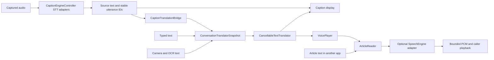

# Hearth model expansion and TTS provider implementation plan

This is the implementation handoff for adding five Arabic and English STT models, five translators, and five TTS models, while preparing a small reusable Hearth TTS library for other Android apps. The primary local device is the owner's Galaxy S25 Ultra. Hearth TVs must not execute or install local models. The owner will perform phone testing later.

Read this file first, then the specialist plan for your task. Work through the acceptance checks before enabling a model in the app. A model card, a downloadable GGUF, a successful native build, and verified phone inference are four different milestones.

## Handoff contents

| File | Purpose |
| --- | --- |
| [STT implementation](stt-implementation.md) | Per-model native APIs, package layouts, bounded streaming contracts, source pins and precise speech file changes |
| [Translation implementation](translation-implementation.md) | GGUF prompt protocol, CTranslate2 integration, Jisr tokenizer/export work and direction-specific selection |
| [TTS and provider implementation](tts-provider-implementation.md) | Small SDK, Supertonic consumer, new voice engines, Arabic article reading, cancellation and publishing |
| [STT cards](models/stt.json) | Five machine-readable STT records with pinned components and remaining blockers |
| [Translation cards](models/translation.json) | Five translation records, exact directions, components and evaluation scope |
| [TTS cards](models/tts.json) | Five TTS records, codec/tokenizer requirements, voice evidence and license restrictions |
| [Readable model cards](models/README.md) | Generated human-readable view of all 15 records and their complete component tables |
| [Task prompts](task-prompts.md) | Copyable bounded assignments for agents unfamiliar with this codebase |
| [Validation record](validation.md) | Checks actually run on this handoff branch; unperformed checks remain explicit |

The earlier broad survey is [model-families-2026-10-19.json](../research/model-families-2026-10-19.json). It is research, not an executable catalog. Prefer the smaller handoff cards for this work. The card files are evidence inputs, not installable archive manifests; do not feed them directly to an existing model importer.

Validate and regenerate the readable cards with `python3 scripts/validate-model-handoff.py --render`. Its six host tests run with `python3 -m unittest discover -s scripts -p test_model_handoff.py`. The validator checks metadata consistency, pinned URL identities, paths, hashes, bilingual coverage and complete component totals; it does not download or execute model weights.

## Start here before changing code

1. Read the repository root `AGENTS.md`. Its constraints apply to every task below.
2. Run `git status --short --branch` and read `git diff --stat`. Preserve other agents' work. This handoff started from release `v0.25.4`, commit `6c15890b284b6c74074d13d7d45d1311d0cf6035`, on branch `codex/s25-models-tts-provider`. Read the current branch rather than assuming the release baseline still describes every file.
3. Read the specialist plan and its five cards. Verify their pinned source revisions before editing a runtime. Do not substitute the newest upstream branch without reviewing the diff and regenerating provenance.
4. Run the smallest relevant baseline test. If it already fails, capture the failure before editing.
5. State the files you own to other agents. Build one family end to end before extending the next. Do not edit shared Gradle, model enums or download dispatch files concurrently.

All code paths below are relative to the repository root. The Android package is still `com.sal7one.transiber`; Hearth is the displayed product name. The JNI package **must remain** `com.sal7one.common_jni`. Renaming these as part of model work breaks existing native bindings or app updates.

## Product requirements

- Local STT, MT and TTS target the S25 Ultra first. Size, first useful output, sustained speed, Arabic/Gulf quality, heat and memory must be measured together. A desktop throughput number is not a phone result.
- TVs use explicit cloud connections. Do not automatically reroute audio or text to a provider, select a paid service, erase saved model choices, or delete installed weights. FOSS remains offline even on TV.
- STT, translation and TTS remain independently selectable stages. Users can use captions without MT/TTS, typed translation without STT, or article TTS without either STT or MT.
- Basic mode offers a few clear bundles. Advanced mode exposes engine, model, precision, backend, paths and diagnostics. Do not make new advanced controls visible throughout Basic mode.
- Support Arabic and English article reading, with explicitly selectable male and female voices when a model supplies verified voices. Do not invent voice gender or silently replace the requested language.
- Article reading is a TTS input use case, not permission to recreate a book reader, editor, FFmpeg pipeline or media downloader.
- Preserve the existing overlay setting that optionally shows original captions while a translation is pending. Preserve translation-only behavior and exact-once final text.
- The reusable TTS core must stay small, have no model weights, no automatic downloads, and no dependency on the Hearth application. Native engines and their weights are optional adapters.

## What exists and what still needs implementation

The branch has progressed beyond the initial preparation checkpoint. The validation
record describes that earlier checkpoint; use the current release notes and the
implementation evidence linked below for subsequent runtime work. Research-selected
variants in the handoff cards are not automatically the live app's selected artifacts.

| Area | Baseline and current branch work | Remaining work |
| --- | --- | --- |
| STT | Existing engines remain; Cohere Arabic, Fun-ASR MLT Nano and Voxtral have ARM64 CPU/Vulkan adapters, packages and [host evidence](../models/stt-native-expansion.md) | Audar and OWSM remain prepared targets; owner S25 quality/memory/speed testing for new adapters |
| GGUF MT | Existing CPU, Vulkan and Adreno OpenCL paths; branch adds EuroLLM and Riva prompt modes and catalog identities | Real-model Arabic parity and S25 measurements; keep results separate from successful builds |
| Other MT | Marian/OPUS and ML Kit remain; [CTranslate2 ARM64 CPU](../models/ct2-translators.md) adds independent QuickMT en→ar / ar→en and SMaLL-100 packages | Production-weight parity and S25 measurements; Jisr still needs its actual tokenizer/export protocol |
| TTS | Small SDK, working Supertonic adapter and separate Magpie ARM64 CPU adapter used by app; [Magpie uses corrected F16 plus authenticated tokenizer ranges](tts-provider-implementation.md) | OmniVoice, MOSS Nano, native Chatterbox Multilingual V3 and OuteTTS adapters; phone validation and standalone Supertonic dependency extraction |
| TV | Branch adds app policy checks at model use, transfer and import boundaries plus TV connection UI | Owner UI/runtime testing; test stale saved local selections as well as fresh installations |
| Cards | Pinned, sourced records for the 15 target models | Promote records into production catalogs only after each adapter satisfies its readiness checks |
| Release | [0.26.0/code 89](../releases/0.26.0.md) prepares a signed QA draft on top of 0.25.4 | Do not label this a completed 15-model integration or a phone-verified release |

[Ming-3.0](../ming-3.0.md) is a separate five-checkpoint hosted expansion with
[complete pinned cards](../models/ming-3.0.json). Its published languages exclude
Arabic, so it is deliberately outside the 15 bilingual target records. TTS uses
the two distinct official APIs; Audio Tiny/Flash are connected for transcription,
and ASR Tiny uses the documented SGLang-Omni endpoint. No local Android Ming runtime
or CUDA inference result is claimed.

New trained weights can count as a new model while sharing an architecture. Audar is explicitly Qwen-derived. Quants and conversions remain variants of one model, not separate model families.

## Codebase map

### App orchestration

| Concern | Read these files | Responsibility |
| --- | --- | --- |
| Caption pipeline | `app/src/main/java/com/sal7one/transiber/caption/CaptionEngineController.kt` | Opens recognition; owns source/final text, translation bridge, session cleanup and voice output |
| Caption configuration | `caption/CaptionOverlayConfig.kt` declares `CaptionConfigStore` too | Persistent engine/model/language/display choices; preserve stored enum values and migration behavior |
| Speech selection | `caption/LocalSpeechModels.kt`, `caption/LocalSpeechSetup.kt`, `models/SpeechArtifactCatalog.kt`, `models/SpeechDownloads.kt` | Verified model packages, installed models, publisher entries and installation |
| Translation selection | `translation/TranslationOptions.kt`, `translation/ConversationTranslationSettings.kt` | Supported direction UI, explicit provider choice and frozen per-request connection snapshots |
| Typed and camera MT | `translation/TypedTranslationController.kt`, `ocr/CameraOcrController.kt` | Both consume the same translator interface; do not implement a separate runtime for each screen |
| App voice output | `voice/VoicePlayer.kt`, `voice/VoiceSettings.kt`, `voice/VoiceCatalog.kt`, `voice/VoiceModels.kt` | One bounded queue, selection, file checks, cancellation, playback and audio focus |
| Model explorer | `models/ModelsScreen.kt`, `settings/settings_speech_local_ui.kt`, `settings/settings_translate_local_ui.kt`, `settings/settings_voice_local_ui.kt` | Browse, search, install/manage and advanced information |
| Downloads | `downloads/DownloadAssets.kt`, `downloads/FileDownloads.kt`, `app/src/play/java/com/sal7one/transiber/downloads/DownloadService.kt` | Catalog identity, resume, checksum verification, atomic installation and explicit later selection |
| Sources | `models/ModelSourceUrls.kt`, `models/ModelSourcePanel.kt`, `preferences/ModelSourceBindings.kt` | Source links, original SAF location bindings, launch revalidation and repair |
| Setup recipes | `setup/PortableSetup.kt`, `setup/PortableSetupCatalog.kt`, `setup/PortableSetupActions.kt`, `setup/PortableSetupPlan.kt`, `setup/LocalBundlePreset.kt` | Import/export, preflight, source/direction validation and applying independent stage settings |
| Startup audit | `preferences/StartupModelAudit.kt`, `preferences/UserPreferences.kt` | One process launch audit; DataStore initialization and user preferences |
| Runtime policy | `runtime/LocalModelPolicy.kt`, `runtime/LocalWorkGate.kt`, `caption/TvControls.kt` | TV restriction and ownership across competing model operations |
| Benchmarks | `benchmark/LocalBenchmarkRunner.kt`, `benchmark/BenchmarkSuite.kt`, `benchmark/BenchmarkAccelerationPlan.kt` | Runs actual production sessions serially and records comparable measurements |

Except for the fully qualified first path, shortened paths in this table are under `app/src/main/java/com/sal7one/transiber/`. Follow imports rather than creating a second copy of an existing helper.

### Shared Kotlin and native runtimes

| Concern | Files under `common-jni/src/main/` | Responsibility |
| --- | --- | --- |
| Speech model contracts | `java/com/sal7one/common_jni/speech/SpeechModels.kt` | Backend/profile identity, source languages, forced-language support, streaming, partials and allowed acceleration |
| Speech package verification | `java/com/sal7one/common_jni/speech/SpeechModelPackage.kt` | Root manifest, exact required files, safe paths, limits and checksums |
| Speech lifecycle | `java/com/sal7one/common_jni/speech/SpeechSession.kt` declares `SpeechRuntime` too; `LiveSpeechProcessor.kt` is in the same directory | Availability, verified load, bounded PCM work and ordered final/partial delivery |
| Speech ABI | `cpp/speech/backend_abi.h`, `speech_session.h`, `speech_session.cpp`, `speech_jni.cpp`, `backend_versions.h` | Plugin functions, source identity, native handles, synchronization and version checks |
| Existing native example | `cpp/speech/backends/transcribepsy_backend.cpp`, `backend_guard.h`, `exports.map` | Isolated DSO, complete bounded utterances, real errors, actual GPU placement checks |
| Translation specs | `java/com/sal7one/common_jni/translation/TranslationCatalog.kt` | Identity, file integrity, exact source/target pairs and publisher prompt |
| Translation lifecycle | `java/com/sal7one/common_jni/translation/LocalTranslationSession.kt`, `CaptionTranslationBridge.kt` | Protocol check, verified loading, cancel/destroy, stable line IDs and bounded final-only MT queue |
| Translation C++ | `cpp/translation/text_model.h`, `translation_jni.cpp`, `vulkan_text_model.h`, `opencl_text_model.h` | Prompt envelope, context/cache reuse, decode, error handling and explicit backend execution |
| Existing ONNX MT | `java/com/sal7one/common_jni/marian/MarianTranslationSession.kt`, `cpp/marian/` | OPUS-specific tokenizer/model layout and decoder cache ownership |
| Existing TTS | `java/com/sal7one/common_jni/voice/SupertonicVoice.kt`, `VoiceText.kt`, `cpp/voice/` | Existing verified model API, text IDs/style data and native synthesis |
| Shared safety helpers | `cpp/common/`, `java/com/sal7one/common_jni/model/ModelIntegrity.kt` | Native handle leases, UTF-8, model integrity, contained staging and ownership |

Before writing any helper read [utils-bible.md](../utils-bible.md). Reuse existing ownership, digest, UTF-8 and chunking code where appropriate. New utilities need a real production consumer and meaningful host coverage.

## Pipeline contracts that must survive every task

The desired graph is `audio → STT → source text → optional MT → optional TTS`. Typed text and article text can enter later stages directly. A workflow file selects and connects existing stages; it never provides executable code or an arbitrary model host.



The app also retains Android/system and cloud voice paths. The standalone article reader does not instantiate an STT or translation stage.

### Speech

`LiveSpeechProcessor` queues bounded PCM and serializes work into `SpeechSession`. The native plugin receives the session's actual source-language selection. The translation target is not an STT language hint. Unknown language stays unknown; it must not become English merely because a decoder omits metadata.

Keep utterance IDs, revisions and final flags stable. A revised partial replaces the same utterance, and one final commits it once. Identical text in two independent utterances must produce two finals. Reset/end/close and cancellation cannot publish stale results into a new session.

The existing capabilities separate windowing from partial output. Use `UTTERANCE_WINDOWED` with the correct `partialResults` flag when the runtime reprocesses a bounded buffer. Mark `CACHE_AWARE` only when the implemented adapter retains genuine acoustic/decoder state across new audio. The Voxtral model architecture alone does not prove the chosen C++ streaming API is cache aware. Never pass an unbounded accumulated live recording to a whole-file API.

### Translation

Implement `CancellableTextTranslator`: stable `id`, explicit `directions`, suspend `translate`, `cancel`, `close`, and actual `executionInfo` where available. Every existing consumer must be able to use the adapter without knowing its architecture.

`ConversationTranslatorSnapshot` freezes provider, credentials, languages and acceleration before opening a request. The overlay bridge attaches MT to the source line's stable ID. Settings edits cannot reroute in-flight text, late results cannot attach to another line, and overload is surfaced instead of silently dropping final text as a successful translation.

An empty or invalid generated result is an inference failure. Do not return the source text as a pretend translation. Same-language passthrough belongs to the explicit application request policy, before opening a translator.

### TTS and article reading

The public SDK returns validated PCM with a declared sample rate, channels and finite samples. It does not own a microphone, translation engine, cloud connection or application navigation. Native adapters own model handles and provide voice inventories. The app owns playback, audio focus and its UI.

Chunk long articles lazily. Preserve Arabic text, paragraph order, punctuation and surrogate pairs. Apply only the selected engine's documented frontend transformations. Keep each emitted PCM frame bounded and apply backpressure; never synthesize an entire article into one `FloatArray` or launch synthesis per sentence concurrently.

Voice identity and language are separate. A male English voice is not proof of a male Arabic voice. Multilingual fixed speakers can advertise both only when upstream explicitly supports that use. For cloned/reference voices record the supplied reference profile; do not label an arbitrary sample male/female automatically. A fallback must be an explicit policy, stay within a supported language, and report the selected voice to the caller.

Cancellation signals the active native call first. Retirement must wait for that call's ownership to end. Suppress stale audio after stop or article replacement, including audio computed before cancellation but delivered afterward. Do not free native model memory from a UI callback while a worker still uses it.

## Model card and readiness contract

The handoff JSON stores model identity, architecture ancestry, true parameter scope, language coverage, each required component, pinned revision, exact URL/size/hash, license, evaluation scope, native route and blockers. Its schema version is independent of existing speech/model ZIP schemas.

For production, explicitly represent these states:

1. **Researched:** source and language coverage checked; no executable claim.
2. **Prepared:** all required artifact identities and packaging steps known; adapter may still be missing.
3. **Runtime integrated:** the adapter compiles, is packaged for the claimed ABI, is discoverable and has host lifecycle tests.
4. **Inference verified:** real model/audio/text parity and error cases pass on the declared host/backend.
5. **Device tested:** the owner measured the exact model/runtime/quant on a named phone.

Installation and activation remain separate states. A complete file is not necessarily verified, a verified package is not necessarily loadable by this APK, and a loaded runtime is not necessarily using the requested GPU.

For cards, put name, supported languages, total required download, voice availability and current readiness first. Hide component hashes, source revisions and backend diagnostics in Advanced details. Use the existing model search and source buttons. Include aliases such as Arabic/العربية, English/الإنجليزية, Gulf/Saudi where applicable, exact family names and engine names. Never label a model merely “GGUF” or “ONNX” as though the format identified its engine.

Do not reuse original-weight quality scores as measured quant scores. Each metric needs dataset/split, direction/language, normalization, precision, evaluator/source and scope. WER and CER are lower-is-better; translation metrics have different scales. Never compare COMET-DA with COMET-22 as one score. A converter's reference-disagreement rate is not human-reference WER. Conversion upload date is not the trained model's release date.

Missing tokenizer, codec, projector, vocoder or reference-encoder files are blockers. Count all required default components once when computing the package total. Store optional components and alternate quants separately. Do not advertise the decoder's size as the full voice or ASR package. Small Git-tracked tokenizer/config files may require computing their content SHA-256; a Git blob ID is not a SHA-256 file digest.

## Implementation sequence

### Wave 1 Shared foundations and working reference path

1. Review the TV policy changes and test stale local selections at runtime, in setup imports, model imports, downloads/retries, OCR, benchmarks and downloaded TTS. Keep Android system TTS distinct from downloaded model inference.
2. Complete the small TTS SDK and its real Supertonic adapter. Confirm the app consumes that adapter and retains cancellation, audio focus, saved voice choices and error reporting.
3. Finish EuroLLM/Riva protocol changes as one atomic Kotlin/native delivery. An APK with new prompt-mode calls and old DSOs must fail with an actionable protocol mismatch, never run a different prompt silently.
4. Validate all handoff card records and render their readable index. Do not enable an adapter-required card's Install/Use action.

### Wave 2 First new engines worth integrating

1. **Cohere Arabic and Fun-ASR MLT:** share a pinned transcribe.cpp runtime build, but register separate model/profile identities. Start with CPU host parity and explicit Arabic/English language selection, then arm64 Vulkan. Use complete bounded utterances. Follow the STT plan.
2. **Magpie v2607:** integrate the official C++ TTS API as an optional runtime. Verify codec and tokenizer/frontend assets and the v2607 speaker-ID ordering before offering voices. Follow the TTS plan; an older converter's speaker IDs must not be assumed correct.
3. **QuickMT:** add a CTranslate2 CPU adapter with exact source and target tokenization. Test EN→AR and AR→EN as separate model identities; download only the direction a bundle needs. CTranslate2's CUDA support does not provide Adreno GPU acceleration.
4. Add only these newly working profiles to Basic bundles after real inference checks. Keep bundle entries as references to existing independent stages, not a second engine implementation.

### Wave 3 Additional families

1. **Audar Flash:** implement the actual Qwen audio-conditioned GGUF path including its required audio projector/encoder and output protocol. Existing Qwen recognition support does not imply the shipped GGUF translation DSO contains multimodal audio support.
2. **OWSM:** add the audio.cpp adapter, exact embedded tokenizer/normalization handling and bounded utterance behavior. Its complete-file text-delta output must remain labeled correctly.
3. **Voxtral Realtime:** first provide a bounded windowed-partial implementation if that is the pinned upstream contract. A later true incremental cache implementation is a separate verified change.
4. **SMaLL-100:** reuse CTranslate2 runtime infrastructure, implement its language tags and compare INT8 Arabic parity. Do not copy QuickMT tokenization assumptions.
5. **Jisr:** implement and verify its custom tokenizer, dialect tags and Marian export. Do not load the original trained checkpoint into the OPUS ONNX adapter or execute Python/pickle in Android.
6. **MOSS Nano:** implement complete UTF-8 text frontend plus LM and codec state. The official Android example's pretokenized prompts are not a complete app integration.
7. **OmniVoice:** implement native model and codec, including quantized-codec parity. Respect noncommercial weights in SDK distribution and downloads.
8. **Chatterbox Multilingual V3:** use the actual V3 graph/weight protocol and all required reference/flow/vocoder components. Native V2 support and English-only Turbo are not substitutes.
9. **OuteTTS 1.0:** implement the correct DAC codec and measured generation loop, not the older Oute 0.3 codec. Keep its throughput requirements and license restrictions visible in Advanced information.

### Wave 4 Product integration and release

1. Add all newly runnable families to catalog-driven explorer/search, direction/language pickers, source links, downloads/imports, source bindings, startup audits and portable setups.
2. Add bundle presets for Arabic accuracy, compact Arabic/English, and article voices only where their required runtimes/files exist. Do not hardcode S25 performance defaults from desktop reports.
3. Persist new choices through existing DataStore infrastructure. Add migrations and compatibility tests. Keep network keys and per-device paths out of portable workflow exports.
4. Extend benchmarks using the actual production adapters; have the owner run the provided speech and article fixtures on the S25 Ultra.
5. Run the release gates and prepare a tagged GitHub draft with honest ready/experimental/not-yet-integrated status. Do not attach APKs directly in chat or upload unsigned installation downloads.

## Shared integrations each model task must audit

### Catalog and model explorer

Do not add only a settings string. Trace catalog identity through supported languages/directions, artifacts, importer, installed detection, runtime open, selection persistence, portable setup resolver, model source bindings and benchmark discovery. Search for the nearest existing profile ID to find all exhaustive mappings. Android/Kotlin compilation catches some enum cases but not string-based routing.

For selectable fields, source languages, forceable language hints, targets and voice languages are distinct sets. For example, Riva supports English↔Arabic but not arbitrary non-English↔non-English translation. Keep cloud capability discovery separate from local model language tables.

### Download and import

Reuse `DownloadAssets` identity lookup, `FileDownloads` transfer records and the existing foreground service. Model IDs, not display filenames, own installation. Never send provider keys to model/file hosts. Retain `ByokPolicy.FEATURE_BYOK` checks in clients and delegated system download paths. FOSS must not acquire Internet or network-state permissions through a new library manifest.

For multi-component models, design an atomic package transaction: validate all required components, stage privately, verify exact hashes, write the root manifest, then publish the complete model directory. A background transfer completing must not select a model for a running session. If a component is missing or wrong, preserve the prior working installation and show the actual failing component.

Keep archive limits, normalized contained paths, symlink/duplicate entry checks and root-manifest requirements. Do not increase every model limit globally to accommodate one large model; add narrowly scoped documented limits with overflow tests. Original `.pt`/`.safetensors` research files are not runtime packages unless an implemented adapter actually reads them.

### User paths and launch checks

External document trees are sources of model files, not trusted handles that survive forever. Preserve persisted SAF grants, app-private verified copies and source bindings. `StartupModelAudit` must keep one IO job per process, report missing grants/files and allow repair without preventing the rest of the app from opening. Recheck actual private file integrity at runtime load even when launch metadata looks valid.

A new model with multiple components must record every required file in its source binding. Reusing a filename or trusting an installed flag is insufficient. Do not hash gigabytes on every Compose recomposition or download progress update; follow the existing metadata/full-verification split.

### Preferences and portable setups

`UserPreferences.store` looks like `SharedPreferences`, but stores user choices in DataStore. Use it for voice/engine/backend/dialect/gender/fallback/rate and selected import location. `CaptionConfigStore` owns caption choices. Preserve explicit user selections across launches and model upgrades; unknown retired IDs should produce a repair notice rather than silently choosing another engine.

Operational journals (`file_downloads`, `model_registry`, diagnostics) intentionally remain separate. Do not migrate download byte-progress into user-preference DataStore or add a second live DataStore for the same file.

Portable setup JSON contains catalog IDs, supported stage configuration, trusted digest references and schema version. It excludes API keys, endpoints/connection secrets, device-local paths and executable code. Validate every stage before applying any changes. TV preview must explain local-stage rejection before Apply or Download. Extend schema/version validation before adding new family-specific fields; preserve existing exported recipes.

### Native builds and acceleration

Use existing pinned standalone build/stage scripts as patterns. `common-jni` uses NDK `27.0.12077973`, Android API 28 minimum, four ABIs, flexible 16 KB page sizes and hidden internal symbols. Native dependencies must match the packaged `libc++_shared.so` and app ABI. Do not share conflicting GGML/llama symbols between independent DSOs. Export only the plugin/JNI symbols needed by the app.

CPU remains an explicit available backend. Vulkan/OpenCL are optional per-engine capabilities. CPU probing must not initialize a GPU driver, and requesting GPU must verify real tensor placement. Report an unavailable backend and let the user choose CPU; do not silently present CPU work as accelerated. Do not claim Android QNN/NNAPI/LiteRT GPU support just because an ONNX graph or vendor GPU exists.

Pin upstream sources, transitive model/runtime revisions, toolchain, build flags, staged `.so` hashes and license notices. Rebuild all affected shipped DSOs when changing a private ABI or prompt protocol. Update source fingerprints and vendor manifests with the staging script instead of manually editing a checksum to match a stale binary.

## Test and acceptance matrix

| Area | Required cases |
| --- | --- |
| STT lifecycle | Load failure, empty/silent input, repeated independent text, partial revisions, forced boundaries, reset, cancellation during load/inference, bounded queues, stale output and exact-once final |
| STT languages | Arabic/English, Gulf samples, explicit language vs Auto, unsupported language, unknown language metadata and no forced target-language recognition |
| MT | Both declared directions, forbidden directions, tokenizer/prompt golden cases, Arabic/English/code-switch text, empty output, cancellation, close/load races and stale line IDs |
| TTS | Arabic/English male/female where verified, strict voice selection, explicit fallback, unknown gender, mixed text, Arabic numbers/diacritics, long paragraphs, finite PCM, sample rate and channels |
| Article reader | Large lazy input, punctuation/surrogate boundaries, one active article, slow consumer/backpressure, stop before first audio, stop during audio, replace article and close while native work is in flight |
| Files | Full component tree, wrong/missing digest, partial download, interrupted replacement, unavailable SAF grant, source file moved/modified, path traversal, archive bombs and unsupported manifest version |
| Persistence | Restart retains choices, migration retains existing settings, unknown IDs remain repairable, workflow import does not overwrite unrelated stages or credentials |
| TV and FOSS | Fresh/stale local choices cannot execute/import/install/download; TV cloud remains explicit; FOSS cloud/download calls fail before any network delegation |
| GPU | Exact backend reported, genuine placement, unsupported GPU failure, CPU probe without driver load, cancelled load ownership and kernel-cache errors |
| Packaging | ABI dependency closure, 16 KB alignment, runtime protocol/source fingerprint match, license assets and no weights/secrets in source or the tiny core AAR |

### Commands

Use JDK 17 for Gradle compilation, a discoverable JDK 21 for the existing Android 16/Robolectric unit tests, Android SDK 36 and the pinned NDK. Do not change project toolchain pins simply because your default `java` is newer. Set `JAVA_HOME` and `ANDROID_HOME` for your own environment rather than committing local SDK paths.

```sh
./gradlew test :app:compilePlayQaKotlin :app:compileFossQaKotlin
./gradlew :hearth-tts:testDebugUnitTest :hearth-tts-supertonic:compileDebugKotlin
./gradlew :common-jni:externalNativeBuildDebug
CXX=clang++ bash common-jni/src/main/cpp/speech/tests/run_speech_tests.sh
CXX=clang++ bash common-jni/src/main/cpp/common/tests/run_common_utils_tests.sh
bash common-jni/src/main/cpp/voice/tests/run_voice_tests.sh
bash common-jni/src/main/cpp/marian/tests/run_marian_tokenizer_tests.sh
python3 -m unittest discover -s scripts/speech -p 'test_*.py'
python3 -m unittest discover -s scripts -p 'test_*.py'
git diff --check
```

The specialist plans contain additional family-specific host commands and real-model fixtures. Host fakes test ownership and errors; they do not establish model accuracy. Before APK delivery also run:

```sh
./gradlew :app:assemblePlayQa :app:assembleFossQa
python3 scripts/verify-release.py
```

Owner device testing is separate. Do not use `adb`, install an APK, record from a device or drive the owner's phone without explicit permission. Prepare repeatable fixtures and instructions instead.

## Owner test pack and promotion criteria

Prepare one short clean MSA clip, one Saudi/Gulf clip, English, code-switching, noisy speech, silence/music and a 20-minute continuous input. Record the model/runtime/quant hashes, source-language choice, backend, cold load, first partial/final, endpoint delay, warm speed, peak memory, queue depth, output/error, temperature trend and battery behavior. Compare the same audio and normalization within one cohort.

For TTS prepare Arabic and English paragraphs, Arabic/English numerals, names, dates, abbreviations, URLs, harakat, mixed script, very long paragraphs and 10–20 minutes of article reading. The owner should hear every claimed male/female voice, change speed, stop before first output, stop mid-sentence, replace an article and background/foreground the app. Store no private article/audio content in diagnostics by default.

Do not predeclare every new model faster or higher quality than the existing model. Promote a model into a default bundle only after the chosen tradeoff is supported by owner measurements and the baseline remains available.

## Release and handoff rules

Read [releasing.md](../releasing.md). Keep the existing signing identity for QA upgrades. Release builds are unsigned unless the maintainer configures production signing; renaming them does not make them installable. Bump versions only for the actual new release, run the full gates, create a source-only archive from the reviewed commit, and put approved artifacts on a tagged GitHub **draft** with accurate readiness notes.

Each implementing agent must hand back: files changed, models actually executable, models still prepared, exact tests/results, source/runtime/model pins, license changes, remaining device checks and a clean diff check. “Supported” without those distinctions is not an acceptable completion report.
