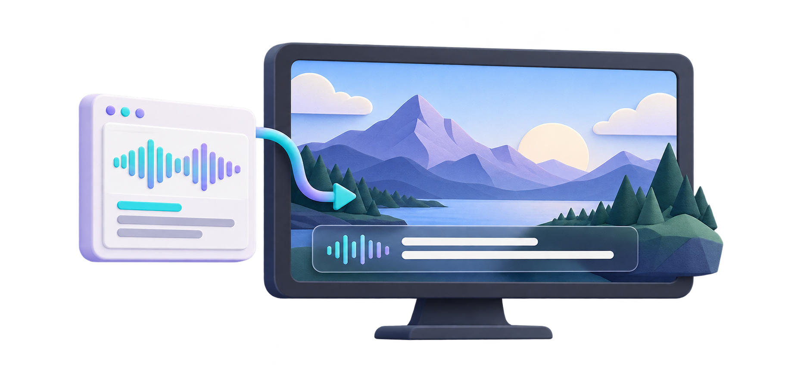

# Put Hearth captions in OBS

Run Hearth Desktop and OBS on the **same computer**. Hearth sends its real caption
results to an OBS Browser Source. You do not need an OBS plugin, provider API key
or a display capture of Hearth's window.

## First setup

1. In Hearth, open **Integrations → Start connection**. Keep Hearth open while
   streaming. This creates the private link; it does not start listening to audio.
2. Select **Copy OBS URL**. Use this caption-only link, **not** the connection
   address or API token. The displayed link hides its private final section; the
   Copy button copies the complete link, including everything after `#`.
   **Preview in browser** opens that same real link to check the caption page.
3. In OBS, use **Sources → + → Browser → Create new**, and name the source
   **Hearth captions**. Leave **Local file** off. Paste the complete copied link
   into **URL**. Set the source's dimensions to your OBS canvas—for example,
   **Width 1920 / Height 1080**—then confirm. Put the source above your video
   sources in the Sources list and leave its eye icon enabled.
4. In Hearth, open **Captions**. Choose microphone or system audio and start the
   session. Play or speak some audio. Check that text appears in Hearth first;
   that same shared session then appears in the OBS source. Translation appears
   when the translation stage is enabled and produces a real result.

The Browser Source background is transparent. Leave OBS's default transparent
Custom CSS in place. For a source that should stay connected across scene changes,
leave **Shutdown source when not visible** off. These property names and behaviors
are described in the [official OBS Browser Source guide](https://obsproject.com/kb/browser-source).

The OBS page has its own caption layout and shows the original text plus any
returned translation. Hearth's floating desktop overlay style/visibility controls
apply to its separate desktop window; they do not change this browser page.

## If captions do not appear

| What you see | What to check |
| --- | --- |
| Hearth has no caption text | Check the selected input, operating-system audio permission, selected speech model/provider and actual error in Captions. A running connection does not prove that speech recognition is running. |
| Hearth has captions; OBS is blank | Check that the Browser source is visible and above your video sources. Verify the dimensions and complete URL, then use the Browser source's refresh control. |
| OBS says disconnected after restarting Hearth or the connection | Select Copy OBS URL again and replace the entire URL in OBS. Restarting revokes the old caption link and can choose a different local port. |
| Only the original text appears | Enable translation in Hearth, select a supported source/destination pair and inspect the translation stage's actual errors. The page cannot create a translation the selected engine has not produced. |
| The previous sentence remains | The page can retain the last completed result. Start a new caption session and wait for new text. Stopping the connection disconnects the source; it does not erase text from a recording already made. |
| The browser preview has a white background | A regular browser supplies its own page background. In OBS the source is transparent; keep the default transparent Custom CSS and layer it over your scene. |
| OBS is on a second computer | This service accepts only local connections. Run Hearth alongside OBS. Do not replace `127.0.0.1`, add router port forwarding or expose the service on your network. |

## What each button copies

| Button | Intended destination |
| --- | --- |
| **Copy OBS URL** | OBS Browser Source URL. The private fragment grants read-only caption access until the connection stops. |
| **Copy address** | The Hearth browser extension or another trusted app on this computer. This address alone does not authenticate requests. |
| **Copy API token** | An explicitly trusted external app. This authorizes API work; OBS does not need it. It is separate from provider API keys. |

Stop the connection when finished. This revokes both integration credentials and
cancels jobs submitted by external apps. A caption session you started inside
Hearth keeps running until you stop it in Captions. Changing browser-extension
access also stops the connection, so copy a fresh OBS URL after starting again.

The local service, private-link authentication, caption event transport and UI
rendering have host test coverage. An actual OBS recording and operating-system
audio capture remain owner checks; this guide does not claim that an OBS process
was controlled during automated validation.

For image uploads, live PCM audio, external-app requests and browser-extension
pairing, see the [integration protocol guide](../desktop-integration/README.md).
