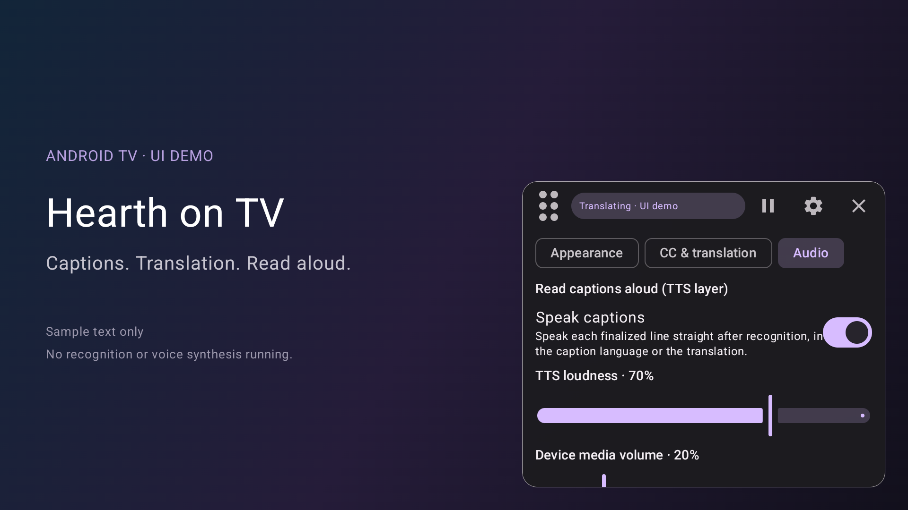
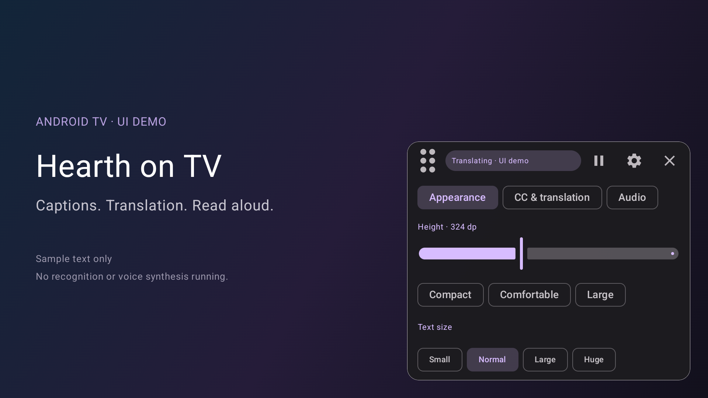
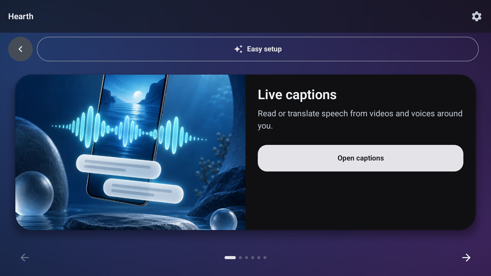
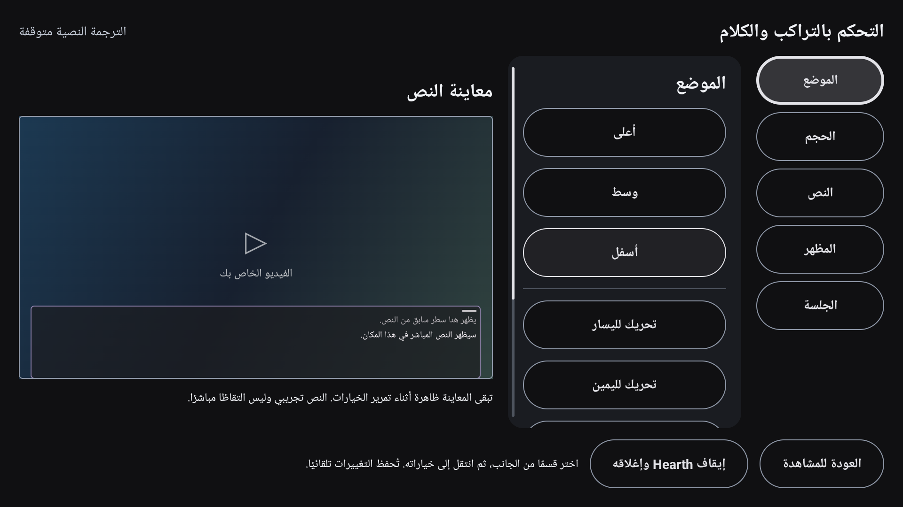

# Hearth on Android TV

Captured on an Android 14 TV emulator using Hearth's real overlay UI.
Captions are labeled sample text; these screenshots do not demonstrate recognition,
translation accuracy or voice playback. [Capture instructions](../../android-abi-support.md#reproduce-tv-screenshots).

## Captions

## Audio loudness

## Voice options

## Appearance

## Home

## Remote-first setup and phone entry

`tv-setup-big-three.png`, `tv-phone-setup-review.png` and
`tv-phone-setup-saved.png` were captured on a disposable Android 14 TV emulator.
The phone flow used a fake test key through a phone-sized browser viewport and
required D-pad OK approval on the TV. No real provider key, speech request or TTS
playback was used. Provider credentials are hidden in the review and success UI.
These captures contain no active pairing QR or provider credential.

## TV overlay editor

`tv-editor-position-tcl.png` was captured on the owner's TCL Smart TV Pro
(Android 14, Arabic interface). The fixed preview uses sample captions, with
category navigation beside an independently scrolling options pane. No provider
credential or live captured text appears in this screenshot.

